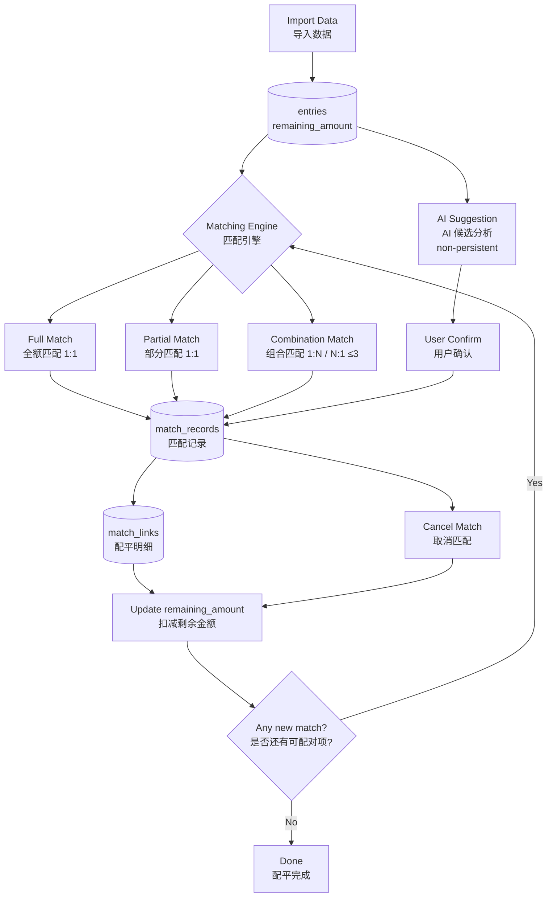
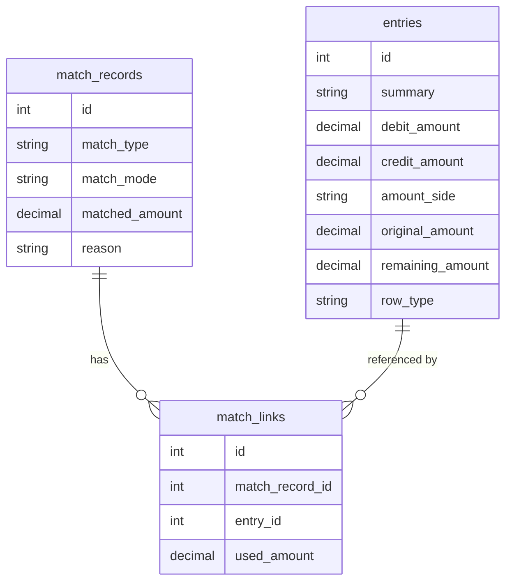
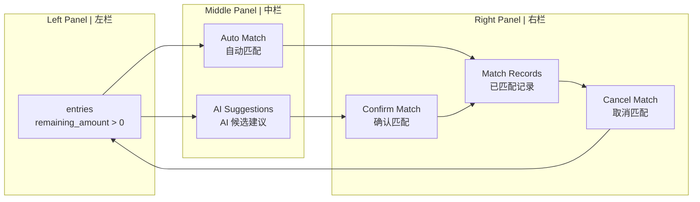

# Entry-Centered Ledger Balance Tool
# 分录驱动配平系统

---

## Core Concept | 核心思想

This tool processes a general ledger by tracking the **remaining balance of each individual entry**, rather than grouping entries by project name.

系统以每条**分录的剩余金额**为核心，而非按项目归组处理。

- Every imported row tagged as `entry` receives an `original_amount` and a `remaining_amount`.
- The matching engine continuously reduces `remaining_amount` by creating match records.
- An entry with `remaining_amount == 0` is fully matched (已配平).
- An entry with `0 < remaining_amount < original_amount` is partially matched (部分匹配).
- An entry with `remaining_amount == original_amount` is unmatched (未匹配).

---

## System Architecture | 系统架构



---

## Data Model | 数据模型



---

## Matching Logic | 匹配逻辑

The engine runs the following strategies in order, repeating until no new match is created:

1. **Full Match (1:1 exact)** — debit `remaining_amount` equals credit `remaining_amount` exactly.
2. **Partial Match (1:1 min)** — match up to the smaller of the two remaining amounts.
3. **Combination Match (1:N / N:1, up to 3 entries)** — find a group of entries on one side whose `remaining_amount` values sum to the other side's amount.
4. **Run in cycle** — steps 1–3 repeat in a loop until no new match record is created.

Matching is triggered either automatically (`run_matching_cycle`) or manually (user selects entries and confirms).

---

## UI Workflow | 界面操作流程



---

## AI Behavior | AI 行为约束

- AI **only provides suggestions** based on entry summaries and amounts. AI 仅提供候选建议。
- AI **does NOT write to the database**. AI 不直接写入数据库。
- A match record is created **only after explicit user confirmation**. 只有用户确认后才会创建匹配记录。

---

## Project Structure | 项目结构

```
src/ledger/
├── services/
│   ├── importer.py          # CSV / Excel import, row_type detection
│   ├── matching_engine.py   # Full / partial / combination matching
│   ├── ai_suggester.py      # AI candidate analysis (read-only)
│   ├── balance_trace.py     # Trace display helpers
│   ├── attribution.py       # Text normalization, correction rules
│   └── exporter.py          # Excel export
├── storage/
│   ├── db.py                # SQLite schema, migration guard
│   └── repository.py        # Data access layer
└── ui/
    ├── main_window.py
    ├── import_page.py
    ├── results_page.py
    └── settings_page.py
```

---

