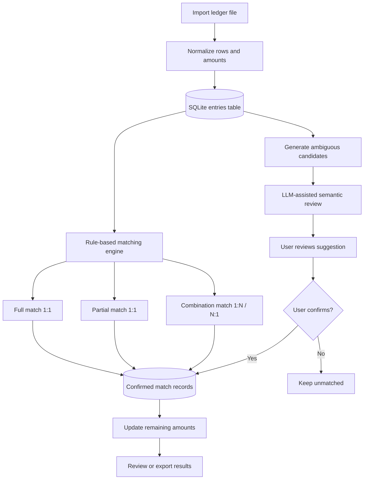
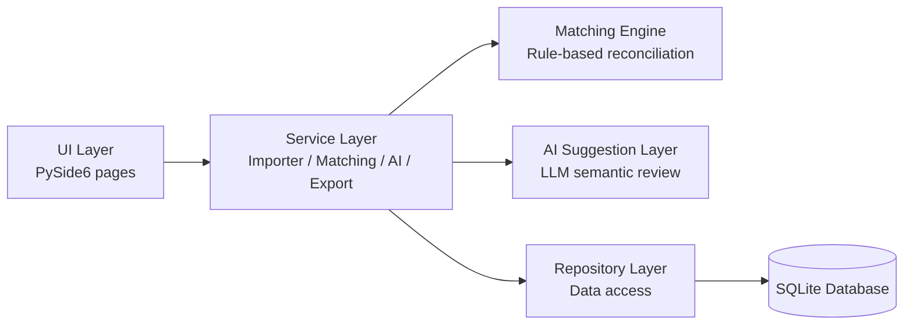

# Ledger Balance Tool

A desktop ledger reconciliation MVP with rule-based matching, SQLite persistence, and LLM-assisted semantic review.

> This project is an early-stage automation project. It is not a fully automated accounting system and not a production-ready enterprise reconciliation platform. The goal is to demonstrate a controlled business workflow where deterministic matching rules, LLM-assisted review, and human confirmation work together.

---

## Overview

Ledger Balance Tool is a Python desktop application for assisting manual ledger reconciliation. It imports ledger files, stores entries locally in SQLite, runs deterministic matching logic for straightforward cases, and uses an LLM API as a semantic verifier for ambiguous candidate matches.

The core design principle is simple:

1. Use deterministic rules where the logic is clear.
2. Use an LLM only for ambiguous semantic review.
3. Keep the human user as the final decision-maker.
4. Persist confirmed matches and remaining balances locally.

---

## Problem Background

Manual ledger reconciliation can be repetitive, slow, and error-prone. Some entries can be matched by amount, but real-world ledger data often contains cases such as:

- multiple entries with the same or similar amounts;
- partial matching where only part of an entry is offset;
- one-to-many or many-to-one combination matching;
- transaction descriptions that require interpretation;
- cases where a user needs to review the reason before confirming a match.

This tool explores how a rule-first workflow and LLM-assisted semantic review can reduce manual screening effort while keeping human control over final decisions.

---

## Core Workflow



---

## Key Features

- **Desktop GUI** built with PySide6.
- **Excel / CSV import** for ledger data.
- **SQLite local persistence** for entries, match records, and remaining balances.
- **Entry-centered matching model** using `original_amount` and `remaining_amount` for each ledger entry.
- **Rule-based matching engine**:
  - full 1:1 amount match;
  - partial 1:1 match using the smaller remaining amount;
  - combination matching up to three entries on one side.
- **LLM-assisted semantic review** for ambiguous candidate matches.
- **Constrained LLM response format** using a fixed prompt that asks for JSON-array output.
- **Human-in-the-loop confirmation** before saving suggested matches.
- **Cancel match** workflow to remove a match record and recalculate remaining balances.
- **Excel export** for reviewing matched and unmatched results.
- **Unit tests** covering core importer, matching, repository, and AI response parsing logic.

---

## AI-assisted Semantic Review

The LLM is used as a semantic verifier, not as a direct database writer.

For ambiguous candidates, the application builds a prompt containing entry summaries, voucher numbers, dates, and matched amounts. The model is instructed to return a JSON array such as:

```json
[
  {
    "pair_index": 1,
    "recommended": true,
    "reason": "The two entries have matching amounts and descriptions that appear to refer to the same business transaction."
  }
]
```

The application then parses the response and displays suggestions to the user. A match is created only after explicit user confirmation.

Current AI-related boundaries:

- the LLM provides suggestions and reasons only;
- malformed JSON responses fall back to an empty suggestion list;
- strict JSON schema validation is not yet implemented;
- final confirmation remains human-controlled.

This makes the AI component a controlled workflow step rather than an autonomous decision-maker.

---

## Architecture



### Layer Summary

| Layer | Main Files | Responsibility |
|---|---|---|
| UI Layer | `src/ledger/ui/` | Import page, results page, settings page, user confirmation flow |
| Service Layer | `src/ledger/services/` | Import, normalization, matching, AI suggestions, export |
| Matching Engine | `matching_engine.py` | Full, partial, and combination matching logic |
| AI Suggestion Layer | `ai_suggester.py` | Prompt construction, LLM API call, JSON response parsing |
| Storage Layer | `src/ledger/storage/` | SQLite schema, repository methods, match records, remaining amounts |

For a more detailed architecture explanation, see [`docs/architecture.md`](docs/architecture.md).

---

## Tech Stack

- **Python 3.10+**
- **PySide6** for desktop GUI
- **SQLite** for local persistence
- **openpyxl** for Excel import/export
- **httpx** for LLM API calls
- **pytest** for unit testing
- **uv** for dependency management, based on the included `uv.lock`

---

## How to Run

### Option 1: Run with uv

```bash
uv sync
uv run python main.py
```

### Option 2: Install locally with pip

```bash
pip install -e .
python main.py
```

The project also defines a console script in `pyproject.toml`:

```bash
ledger
```

### LLM API Configuration

The application uses a settings page for the MiniMax API key and model name. API settings are stored locally through the application's settings storage.

For production or team usage, API key storage should be hardened with encrypted credential storage. See [`docs/future_work.md`](docs/future_work.md).

---

## Testing

Run the test suite with:

```bash
uv run pytest -q
```

Current tests cover:

- importer behavior and row normalization;
- full, partial, and combination matching logic;
- repository persistence and remaining amount recalculation;
- LLM response parsing and AI suggestion constraints.

The current suite focuses on service and storage logic. UI testing and large-scale performance benchmarking are future improvements.

---

## Repository Structure

```text
ledger-balance-tool/
├── main.py
├── pyproject.toml
├── uv.lock
├── src/ledger/
│   ├── config.py
│   ├── services/
│   │   ├── importer.py
│   │   ├── matching_engine.py
│   │   ├── ai_suggester.py
│   │   ├── attribution.py
│   │   ├── balance_trace.py
│   │   └── exporter.py
│   ├── storage/
│   │   ├── db.py
│   │   └── repository.py
│   └── ui/
│       ├── main_window.py
│       ├── import_page.py
│       ├── results_page.py
│       └── settings_page.py
├── tests/
└── docs/
    ├── architecture.md
    └── future_work.md
```

---

## Limitations

This project is an MVP and has important limitations:

- matching logic is mainly amount-based and does not yet use vendor names, account codes, reference numbers, historical patterns, or advanced text similarity scoring;
- combination matching is intentionally limited to small groups;
- AI response handling uses JSON parsing but not strict schema validation;
- API key storage is local and not encrypted for production use;
- there is no full operation audit log yet;
- the tool is designed for single-user desktop usage, not multi-user enterprise deployment;
- performance has not been benchmarked on very large ledgers.

---

## Future Work

Planned or possible improvements include:

- stricter structured output validation with Pydantic or `jsonschema`;
- richer matching signals such as date proximity, vendor/reference extraction, account code, and text similarity;
- confidence scoring to prioritize human review, not to auto-confirm financial matches;
- batch confirmation and better review UX;
- encrypted API key storage;
- operation logs for better traceability;
- larger test datasets and evaluation metrics;
- performance profiling for larger ledgers;
- possible LangGraph-style workflow representation in a future refactor.

See [`docs/future_work.md`](docs/future_work.md) for details.

---

## Project Positioning

This repository demonstrates an early-stage AI-assisted business workflow project:

- not a toy chatbot;
- not a fully autonomous Agent;
- not a production-ready accounting system;
- but a working MVP that combines rule-based automation, LLM-assisted semantic review, human confirmation, and local persistence.

