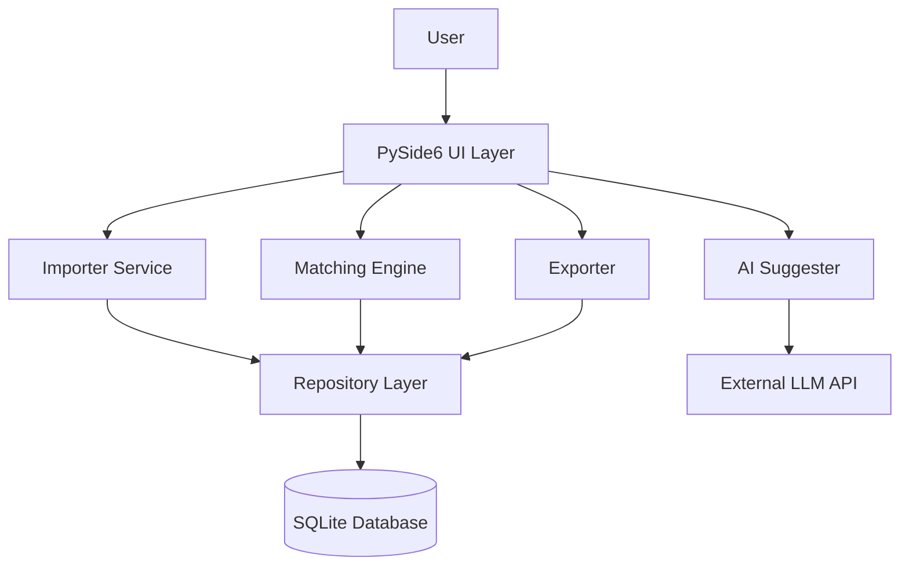
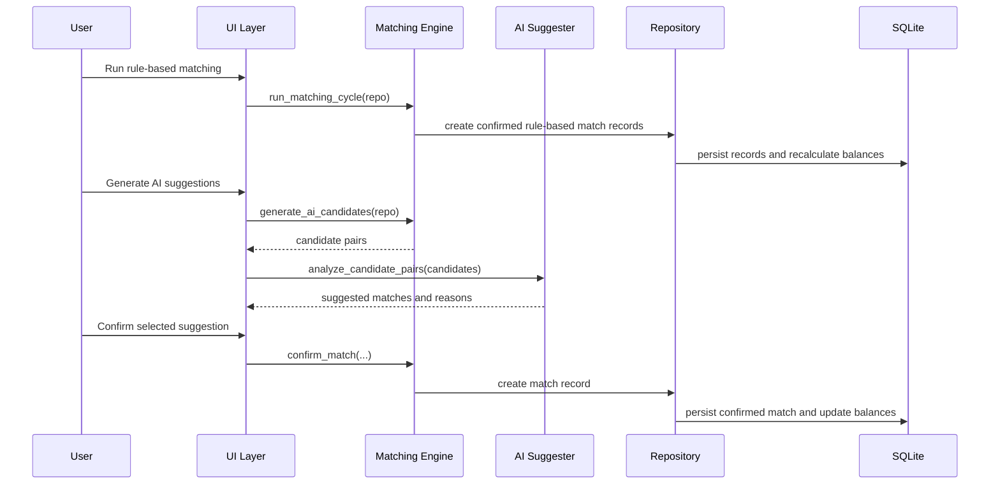

# Architecture

Ledger Balance Tool is a single-user desktop workflow application for assisting ledger reconciliation. It uses a layered architecture that separates presentation, business logic, AI-assisted review, and local persistence.

---

## High-level Design

The application is intentionally local-first. It does not currently implement a backend server, SaaS deployment, multi-user workflow, or full autonomous Agent architecture.

---

## UI Layer

**Location:** `src/ledger/ui/`

The UI layer is built with PySide6 and provides pages for:

- importing ledger files;
- reviewing unmatched entries and match records;
- running automatic matching;
- generating AI suggestions;
- confirming or cancelling matches;
- configuring the MiniMax API key and model name.

Main files:

- `main_window.py` — main application window and tab navigation;
- `import_page.py` — import workflow;
- `results_page.py` — matching, AI suggestions, confirmation, and cancellation UI;
- `settings_page.py` — API key and model settings.

The UI layer calls service and repository functions. It should not contain the core reconciliation logic.

---

## Service Layer

**Location:** `src/ledger/services/`

The service layer contains the main business logic.

### Importer

**File:** `importer.py`

Responsibilities:

- load Excel or CSV ledger files;
- check required ledger columns;
- normalize dates, amounts, and row types;
- distinguish entry rows from opening balance, period total, and year total rows;
- create normalized `ImportedLedgerRow` objects for storage.

### Matching Engine

**File:** `matching_engine.py`

Responsibilities:

- list open debit and credit entries;
- create deterministic matches;
- generate candidate pairs for AI-assisted review;
- confirm user-approved matches;
- cancel match records and recalculate remaining balances.

Current matching strategies:

1. **Full match:** one debit entry and one credit entry have equal remaining amounts.
2. **Partial match:** one debit entry and one credit entry are matched using the smaller remaining amount.
3. **Combination match:** up to three entries on one side sum to a target amount on the other side.

The engine repeats the matching cycle until no new deterministic match is created.

### AI Suggester

**File:** `ai_suggester.py`

Responsibilities:

- receive candidate pairs from the matching engine;
- build a fixed prompt with entry summaries, voucher numbers, dates, and amounts;
- call the MiniMax LLM API through `httpx`;
- request JSON-array output;
- parse the response into `AiMatchSuggestion` objects;
- return suggestions to the UI for human review.

The AI suggester is read-only. It does not write directly to the database.

### Exporter

**File:** `exporter.py`

Responsibilities:

- export matched and unmatched entries;
- generate Excel output for review or downstream handling.

---

## Storage Layer

**Location:** `src/ledger/storage/`

The storage layer uses SQLite for local persistence.

Main files:

- `db.py` — database connection, schema creation, and migration guard;
- `repository.py` — data access layer for entries, match records, settings, and remaining amount recalculation.

Core tables:

- `entries` — ledger entries and their `original_amount` / `remaining_amount` state;
- `match_records` — confirmed match decisions;
- `match_links` — links between match records and ledger entries;
- settings table or equivalent repository methods for local configuration.

---

## Entry-centered Data Model

Each imported entry is tracked with two important fields:

- `original_amount` — the amount at import time;
- `remaining_amount` — the amount still unmatched after confirmed matches.

Possible states:

| State | Meaning |
|---|---|
| `remaining_amount == original_amount` | Unmatched |
| `0 < remaining_amount < original_amount` | Partially matched |
| `remaining_amount == 0` | Fully matched |

When a match is confirmed, a `match_record` and related `match_links` are created. The repository then recalculates remaining amounts based on the links.

---

## Human Confirmation Flow

Important boundary: the LLM can suggest; only the user can confirm.

---

## Current Limitations

The architecture is intentionally simple and MVP-oriented. Current limitations include:

- no backend server or multi-user access control;
- no encrypted credential storage;
- no full operation audit log;
- no strict JSON schema validation for LLM responses;
- no large-scale performance benchmark;
- limited matching features beyond amount and simple combinations;
- no framework-based Agent orchestration such as LangGraph.

These are reasonable boundaries for a local desktop MVP, but they should be addressed before any enterprise or team deployment.

